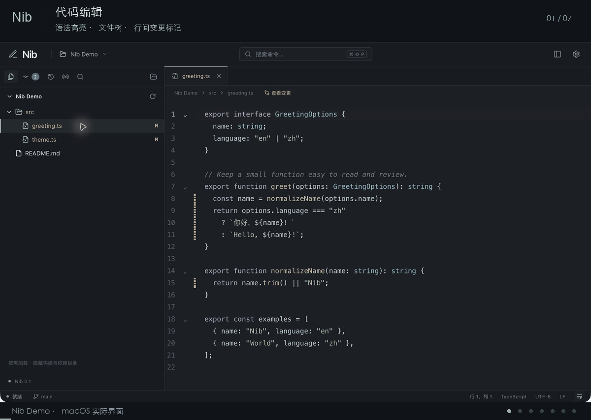

<p align="center">
  
</p>

<h1 align="center">Nib · 笔尖</h1>

<p align="center">专注编辑，轻巧落笔。</p>

<p align="center">
  轻量代码编辑器，集成 Git 可视化与外部文件变更预览。<br />
  适合日常改代码、审查差异，以及查看 AI 编程工具写入项目的内容。
</p>

<p align="center">
  <a href="https://github.com/liuleiCain/Nib/releases">版本下载</a> ·
  <a href="#从源码运行">源码运行</a> ·
  <a href="#打包应用">打包应用</a> ·
  <a href="https://github.com/liuleiCain/Nib/issues">问题反馈</a> ·
  <a href="LICENSE">MIT 许可证</a>
</p>

## 演示



使用独立示例项目展示 macOS 上的实际界面：快速打开文件、多文件切换、Git 左右对比、跨文件改动导航与统一差异视图。

## 为什么做 Nib

我很喜欢 IntelliJ IDEA、GoLand 这些 IDE，尤其是它们的编辑体验和 Git 工作流。但它们也比较重，内存占用较高。只是打开项目、修改代码、查看差异时，我希望有一个更轻巧的选择。

这就是做 Nib 的初衷：**做一个内存占用低、轻量的代码编辑器，同时保留自己喜欢的编辑体验与 Git 操作方式。** 低内存占用是项目持续优化的目标。

Nib 把代码编辑、文件变化和 Git 操作放在同一个桌面窗口中。Git 提交与差异查看的交互参考 GoLand，采用勾选文件提交的方式；使用 AI 编程工具时，也能方便地核对外部工具对项目的修改。当前提供基础编辑与 Git 工作流，尚未集成 LSP、代码补全、终端或调试器。

项目基于 **Tauri 2、Rust、React、TypeScript、Vite 和 CodeMirror 6**，目前处于早期迭代阶段，主要在 macOS 上开发和验证。

## 功能概览

| 功能           | 说明                                                                         |
| -------------- | ---------------------------------------------------------------------------- |
| 多项目与多标签 | 打开多个项目，恢复上次打开的项目与文件；标签独立保留选区、阅读位置和撤销历史 |
| 代码编辑       | 语法高亮、行号、括号匹配、缩进、查找替换、自动换行与自动保存                 |
| Git 差异       | 左右对比和统一视图、语法高亮、折叠未变化代码、按块回滚、跨文件变更导航       |
| 提交与历史     | 勾选文件提交、提交前保存、查看当前分支的提交记录及文件差异                   |
| 分支与远程     | 分支切换、新建、重命名和删除，Fetch、Pull、Push，以及合并和变基              |
| 实时变更       | 监听外部程序写入，查看文件最新磁盘内容及相对 HEAD 的差异                     |
| 修改冲突处理   | 对比磁盘内容与未保存编辑，手动合并或按块采用磁盘内容                         |
| 搜索与命令     | 文件名模糊搜索、项目全文搜索、命令面板和快捷键                               |
| 设置与恢复     | 字体、字号、缩进及 Git 显示设置，异常退出后的未保存内容恢复                  |

支持语法高亮的语言：Go、Rust、JavaScript / JSX、TypeScript / TSX、JSON、Markdown、YAML。

macOS 使用原生窗口标签组织多个项目，可拖出为独立窗口；Windows、Linux 使用独立项目窗口。

## 安装

在 [Releases](https://github.com/liuleiCain/Nib/releases) 查看已发布的版本及附件。若尚无适合你系统的安装包，可以按下文从源码构建。

macOS 安装方式：

1. 下载适合芯片架构的 `.dmg`：Apple Silicon 对应 `aarch64` / `arm64`，Intel 对应 `x64` / `x86_64`；`universal` 同时支持两者。
2. 打开 `.dmg`，将 **Nib.app** 拖入「应用程序」。
3. 启动 Nib，点击「打开文件夹」，选择本地项目。

Git 功能需要本机已安装 Git，并配置好提交身份与远程认证。Nib 沿用本机 Git 配置、SSH 密钥、凭据助手及提交钩子。普通文件夹也可以正常编辑。

> 本地构建默认没有 Apple 开发者签名与公证；通过网络分发的未签名应用可能被 macOS 拦截。Windows、Linux 尚未完成实机验证。

## 从源码运行

### 环境要求

- **Node.js**：22.12 及以上的 22.x，或 24 及以上版本；使用 npm 安装依赖。
- **Rust**：最新 stable 工具链，通过 [rustup](https://rustup.rs/) 安装，并确保 `cargo` 位于 `PATH`。
- **Git**：用于拉取源码及应用内 Git 功能。
- **平台依赖**：macOS 需要 Xcode Command Line Tools（`xcode-select --install`）；Windows 需要 MSVC 工具链、Visual Studio C++ Build Tools 和 WebView2；Linux 需要 WebKitGTK 4.1 等系统库。详见 [Tauri 环境要求](https://v2.tauri.app/start/prerequisites/)。

### 启动开发环境

```sh
git clone https://github.com/liuleiCain/Nib.git
cd Nib
npm ci
npm run desktop
```

`npm run desktop` 会启动前端开发服务并打开原生桌面窗口。如果刚安装 Rust，终端仍找不到 `cargo`，先执行：

```sh
source "$HOME/.cargo/env"
```

`npm run dev` 仅用于浏览器预览界面，不具备本地项目访问能力；完整功能请使用桌面模式。

## 打包应用

在安装好上述依赖的 macOS 环境中执行：

```sh
# 构建 .app 和 .dmg
npm run desktop:build

# 仅构建 .app
npm run desktop:build -- --bundles app
```

默认按当前电脑的芯片架构构建，产物位于：

```text
src-tauri/target/release/bundle/
├── macos/Nib.app
└── dmg/*.dmg
```

构建同时支持 Apple Silicon 和 Intel 的 macOS 通用版本：

```sh
rustup target add aarch64-apple-darwin x86_64-apple-darwin
npm run desktop:build -- --target universal-apple-darwin
```

通用版本产物位于 `src-tauri/target/universal-apple-darwin/release/bundle/`。分发时提供 `.dmg` 或 `.app` 即可，前端资源已包含在应用中，无需另行分发 `dist` 目录。

Windows 和 Linux 需在对应系统配置依赖后，分别使用 `npm run desktop:build -- --bundles nsis` 或 `npm run desktop:build -- --bundles deb`。正式发布 macOS 版本时，还需配置开发者签名与公证。

## 常用工作流

### 编辑与外部修改

打开文件夹后，从文件树选择文件，或使用快速打开定位文件。文件树支持新建、重命名、移到废纸篓、复制路径和 Git 操作。

自动保存默认开启：停止输入约 1 秒、切换标签或窗口失去焦点时保存，可在设置中关闭。保存会检查磁盘版本，防止覆盖外部修改。

外部工具修改文件后，干净标签会自动刷新；如果编辑器中也有未保存内容，Nib 会保留草稿并暂停该文件的自动保存。点击文件上方的「对比并处理」，可以手动合并、采用磁盘版本，或保存合并结果。

### 查看差异与提交

1. 打开侧边栏「提交」，查看「变更」和「未跟踪文件」。已跟踪的变更默认勾选，未跟踪文件按需勾选。
2. 点击文件查看差异。工作区与历史差异复用一个 **Git 差异** 标签，并使用独立配色，与普通文件标签区分。
3. 新打开的差异默认定位首处改动。使用顶部上下箭头或 `F7` / `Shift+F7` 前后导航；到达文件边界后进入相邻文件，整个列表首尾禁用相应按钮，不循环。
4. 左右对比通过中间的回滚按钮恢复一处改动；统一视图通过变更块右上角的回退图标回滚。也可以从编辑器行号旁的变更标记查看和回滚。
5. 填写提交信息，提交勾选的文件；推送前可预览待推送提交及其差异。

**提交以文件为单位**：采用 `git commit --only`，不单独展示暂存区，也不支持按行或按块提交。同一文件的已暂存和未暂存修改合并展示，勾选后提交该文件的工作区内容，其他文件的暂存状态保持不变。

差异视图按块回滚会立即写回文件；文件已打开时可在编辑器中撤销。有未保存编辑或磁盘版本已变化时会拒绝回滚。文件级回滚会先确认，修改和删除恢复为 HEAD；新增文件取消加入版本控制并保留磁盘文件。

### 配合 AI 编程工具

在外部终端或 AI 工具中操作项目，打开 Nib 的「实时变更」面板即可查看文件变化。Git 项目预览 HEAD 与当前磁盘的差异；普通文件夹预览最新内容。

点击文件可以固定阅读，点「跳到最新」才会切换到最近变化的文件并定位写入处。预览只读，不提供回滚，也不记录内容历史；未保存的编辑会单独提示。

### 分支、远程与搜索

- 点击状态栏或提交面板的分支名，打开分支与远程操作。支持分支管理、获取、拉取、推送、合并和变基；拉取仅做快进，推送不提供强制覆盖。
- 合并或变基发生冲突时，在编辑器中处理冲突标记，标记已解决后从提交面板继续或中止。当前没有三方合并视图。
- 快速打开支持文件名模糊匹配，以及 `路径:行号` 定位。项目搜索支持大小写、全词和正则选项，搜索的是磁盘内容。
- 顶部「搜索命令…」可查找并执行操作；右上角设置可调整字体、字号、缩进、自动换行、自动保存与 Git 显示方式。

## 快捷键

| 操作                   | macOS                       | Windows / Linux                       |
| ---------------------- | --------------------------- | ------------------------------------- |
| 打开文件夹             | `Cmd+O`                     | `Ctrl+O`                              |
| 新建项目窗口 / 标签    | `Cmd+Shift+N`               | `Ctrl+Shift+N`                        |
| 保存 / 全部保存        | `Cmd+S` / `Cmd+Shift+S`     | `Ctrl+S` / `Ctrl+Shift+S`             |
| 关闭当前标签           | `Cmd+W`                     | `Ctrl+W`                              |
| 快速打开文件           | `Cmd+P`                     | `Ctrl+P`                              |
| 命令面板               | `Cmd+Shift+P`               | `Ctrl+Shift+P`                        |
| 当前文件查找与替换     | `Cmd+F`                     | `Ctrl+F`                              |
| 项目搜索               | `Cmd+Shift+F`               | `Ctrl+Shift+F`                        |
| 撤销 / 重做            | `Cmd+Z` / `Cmd+Shift+Z`     | `Ctrl+Z` / `Ctrl+Shift+Z` 或 `Ctrl+Y` |
| 切换侧边栏             | `Cmd+B`                     | `Ctrl+B`                              |
| 打开提交面板           | `Cmd+K`                     | `Ctrl+K`                              |
| 提交勾选文件           | `Cmd+Enter`                 | `Ctrl+Enter`                          |
| 打开推送预览           | `Cmd+Shift+K`               | `Ctrl+Shift+K`                        |
| 下一处 / 上一处变更    | `F7` / `Shift+F7`           | `F7` / `Shift+F7`                     |
| 设置                   | `Cmd+,`                     | `Ctrl+,`                              |
| 增大 / 减小 / 重置字号 | `Cmd++` / `Cmd+-` / `Cmd+0` | `Ctrl++` / `Ctrl+-` / `Ctrl+0`        |

文件树和提交面板的右键菜单还提供查看差异、加入版本控制、回滚等操作，快捷键显示在菜单中。自动换行可从底部状态栏切换，更多操作可在命令面板搜索。

## 本地数据与内容恢复

Nib 将设置、会话与恢复数据保存在当前用户目录的 `.nib` 下：macOS / Linux 为 `~/.nib/`，Windows 为 `%USERPROFILE%\.nib\`。

| 路径            | 内容                                     |
| --------------- | ---------------------------------------- |
| `settings.json` | 编辑器、Git 和窗口显示设置               |
| `session.json`  | 最近项目、已打开项目与文件标签等会话记录 |
| `recovery/`     | 未保存内容的恢复数据                     |

发生崩溃或强制退出后，重新打开项目可选择恢复未保存内容，也可从命令面板执行「恢复上次未保存的内容」。恢复数据约每 1.5 秒写入一次，不作为文件版本历史；超过约 150 万字符的文件不写恢复数据。

## 当前限制

- **编辑能力**：仅支持 UTF-8 文本（含 BOM），保留原有 LF、CRLF 或 CR 换行。暂不支持非 UTF-8、混合换行、二进制预览和项目外符号链接；超过 20 MiB 的文件只读预览开头 5 MiB。
- **大文件与差异**：普通编辑器超过约 105 万字符时使用简化模式；Diff 单侧超过 5 MiB 不显示内容，大文件降低差异计算精度。变更列表最多展示 5,000 个文件，子模块仅显示状态。
- **Git 范围**：不提供 Stash、Reset、Clean、拣选、交互式变基、强制推送或标签管理。提交历史为当前 HEAD 的线性列表，合并提交只与第一个父提交比较。
- **远程认证**：不在应用中输入或保存账号密码，需要交互认证或确认 SSH 主机密钥时，请先在终端完成。远程操作暂不支持中途取消。
- **搜索范围**：快速打开最多索引 50,000 个文件；项目搜索最多约 2,000 处结果、单文件 200 处，跳过超过 5 MiB 或非 UTF-8 文件。项目搜索暂不支持批量替换；正则使用 Rust `regex` 语法，不支持环视和回溯引用。
- **配置与无障碍**：暂不读取 `.editorconfig`，缩进使用空格；虚拟列表只渲染视口附近的条目，读屏和页内查找的覆盖范围受限。

## 开发与贡献

欢迎通过 [Issues](https://github.com/liuleiCain/Nib/issues) 反馈问题或提出建议，也欢迎提交 Pull Request。较大的功能调整建议先开 Issue 讨论。

报告问题时请附上操作系统与芯片架构、Nib 版本、复现步骤、预期与实际结果，以及必要的截图或日志。提交前请移除项目内容、凭据等敏感信息。

```sh
# 前端类型与格式检查
npm run typecheck
npm run format:check

# 前端生产构建
npm run build

# Rust 格式与静态检查
cargo fmt --manifest-path src-tauri/Cargo.toml --check
cargo clippy --manifest-path src-tauri/Cargo.toml -- -D warnings
```

项目结构与模块职责见 [架构说明](docs/architecture.md)。

## 许可证

Nib 基于 [MIT License](LICENSE) 开源。
